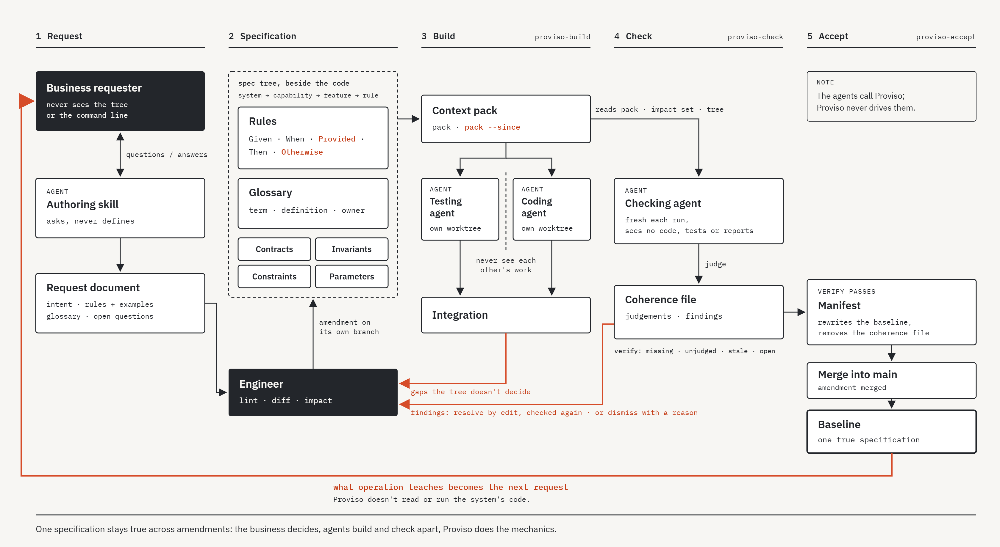

# Proviso

Proviso keeps one specification of a system true across many changes.
The specification is a **spec tree**: Markdown files beside the system's
code. Every change starts as an **amendment**, an edit of that tree on a
branch. Proviso checks the tree, works out what the amendment changed and
what it may affect, and hands the agents that build and check it exactly
what they need. It serves systems in any language, and never reads their
code.

Agents write code faster than anyone can review it, so checking it has
to be automated as well: a testing agent, independent of the coding
agent, derives tests from the specification. Those tests check
something only if the specification states the system's behaviour
precisely: what happens when a condition does not hold, where its
boundaries lie, what its terms mean. The spec tree is written for that
reader, and Proviso keeps it true as the system changes: a format can
make someone decide, but it cannot make the decision arrive.



## Install

Download the archive for your platform from the
[releases](https://github.com/bbak/proviso/releases), unpack it, and put
`proviso` in a folder on your path.

## Set up a repository

The first spec tree is the first amendment, so start on a branch, in
the repository's root:

```sh
git switch -c first-spec
proviso init
```

`init` writes the start of the spec tree in `proviso/`, the skills and
agent definitions for Claude Code in `.claude/`, and stubs for your
notes in `.proviso/`. Name your project's build and test commands in
`.proviso/build.md`, and commit everything.

## Use it

1. **Specify:** edit the tree on the amendment's branch. `proviso lint`
   checks the notation, `proviso diff` shows what changed, and
   `proviso impact` what it may affect. If the amendment deliberately
   leaves something out, list it in `proviso/.amendment.md`. Commit the
   tree, and the note if there is one.
2. **Build:** ask Claude Code to build the amendment. A testing agent
   and a coding agent build from the tree, apart from each other; every
   decision the tree did not make comes back to you.
3. **Check:** ask it to check the amendment. An independent agent judges
   whether the tree still holds together; you resolve or dismiss each
   finding.
4. **Accept:** ask it to accept the amendment. It is merged, and the tree
   becomes the new baseline.

Run `proviso verify` in CI, so that no amendment reaches the target
branch unchecked.

## Status

Proviso has been validated only on command-line applications written in
Go, with Claude Code and primarily Claude Opus 5.5. A skill that brings
a request into the tree, and one that guides business requesters to a
checkable request, are in the works.

## Documentation

The [documentation](docs/index.md) covers
[getting started](docs/getting-started.md),
[concepts](docs/concepts.md), the [workflow](docs/workflow.md),
[writing specs](docs/writing-specs.md),
[repository setup](docs/repository-setup.md) and the
[commands](docs/commands.md). Proviso specifies itself: its own spec tree
is in [`proviso/`](proviso/).
